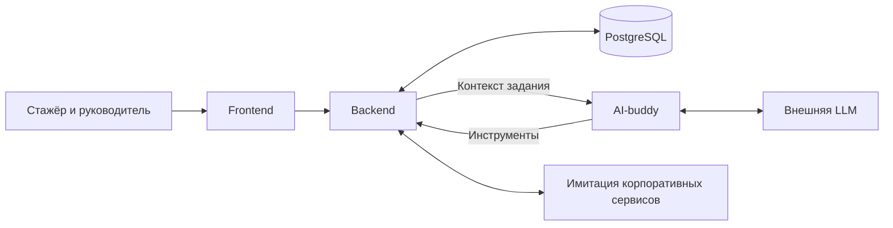

# AI-buddy

AI-buddy помогает стажёру Авито освоиться в команде. Стажёр видит свой план, задаёт вопросы по текущему заданию и отслеживает результат. Проект для кейса Авито на Hack&Change 2026.

## Пользовательский путь MVP

1. Стажёр открывает «Мой план» и выбирает пункт или нажимает «Продолжить адаптацию».
2. В пункте «Знакомство с командой» узнаёт, чем занимается команда, кто руководитель и кто наставник. После общения нажимает «Отметить знакомство».
3. В пункте «Рабочие доступы» проверяет ресурсы своей команды и запрашивает недостающие по одному или сразу. Руководитель рассматривает каждую заявку на экране «Заявки команды».
4. После знакомства и подтверждённой выдачи всех обязательных доступов стажёр видит «2 из 3 этапов». Карточка «Первая задача» показывает «Скоро».

**Два рабочих сценария MVP** — знакомство с командой и получение всех обязательных доступов. Для демо команда использует вики, YouTrack, GitLab и Grafana. По каждому ресурсу стажёр видит результат выдачи.

## Экраны по макету

| Где | Что видно |
| --- | --- |
| «Мой план» | Один список из трёх этапов. Внутри двух рабочих этапов есть вкладки «Задание» и «Чат с AI-buddy». У каждого этапа своя переписка. |
| Боковая панель | «Путь адаптации», ближайшая встреча с наставником на демо-данных и сводка «Мои заявки». |
| Профиль | Имя, роль, команда и рабочая почта. Открывается по аватару. |
| «Мои заявки» | Номер, ресурс и статус каждой заявки. Можно открыть детали и отфильтровать заявки. |
| «Заявки команды» | Очередь руководителя. В карточке видны стажёр, ресурс, уровень доступа и причина запроса. |

«Первая задача» — заглушка. Она показывает, какие шаги подготовки осталось пройти. После знакомства и получения всех обязательных доступов появляется статус «Скоро».

## Как работает система

Frontend на **React и TypeScript** показывает план, чаты и заявки. Backend на **Go** проверяет права, сохраняет данные в **PostgreSQL** и обновляет статусы. AI-buddy получает данные текущего задания через инструменты backend. Для проверки и выдачи доступов используем имитацию корпоративных сервисов.



### Инструменты агента

| Инструмент | Что даёт помощнику |
| --- | --- |
| `get_intern_profile` | Контекст стажёра и его команды. |
| `get_onboarding_checklist` | Пункты плана и их статусы. |
| `get_mentor_info` | Рабочие сведения о наставнике. |
| `get_role_tools` | Обязательные ресурсы для команды и роли. |
| `check_tool_access` | Состояние доступа к выбранному ресурсу. |
| `prepare_access_request` | Черновик по одному или нескольким ресурсам. |
| `get_access_request_status` | Текущий статус заявки. |

Планируемая структура проекта

```text
frontend/   # Интерфейс
backend/    # API, заявки и имитации сервисов
ml/         # Помощник, промпты и SDD
docs/       # Документация
```

## Документация

- Компоненты системы, заявки, права и фоновая обработка. [Архитектура MVP](docs/architecture.md)
- Шаги стажёра и руководителя, статусы и условия завершения. [Сценарии MVP](docs/scenarios.md)
- Проверка пользы чата в сценарии знакомства. [План пилота](docs/pilot.md)

## Что подготовить к сдаче

- Инструкцию локального запуска, версии зависимостей и тестовые учётные данные. Для запуска планируем Docker Compose.
- Пример конфигурации без секретов. Указываем название внешней модели и способ передать ключ.
- SDD-спецификации помощника и его инструментов.
- Тестовые данные, имитации сервисов, команды запуска тестов и воспроизводимый отчёт. По ТЗ покрытие строк прикладного кода должно быть выше 80%. Зависимости, сгенерированный код и сами тесты исключаются из расчёта.
- Презентацию в PDF и видеодемонстрацию.
