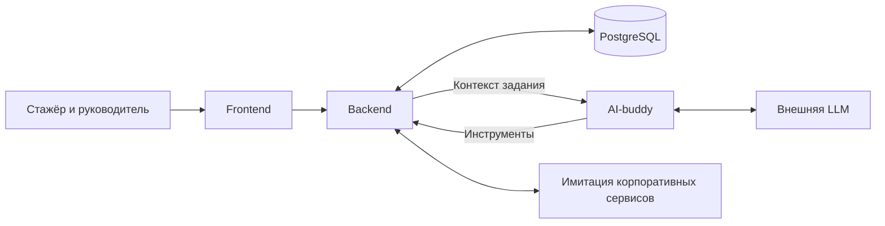

# AI-buddy

AI-buddy помогает стажёру Авито освоиться в команде. Стажёр видит свой план, задаёт вопросы по текущему заданию и отслеживает результат. Проект для кейса Авито на Hack&Change 2026.

## Пользовательский путь MVP

1. Пользователь вводит демо-почту или внутренний ID. Для нового профиля стажёр видит назначенную ему команду, выбирает наставника, должность и дату начала стажировки. Роль и команду backend берёт из тестового справочника.
2. Стажёр открывает «Мой план» и выбирает пункт или нажимает «Продолжить адаптацию». Руководитель сразу попадает в «Заявки команды».
3. В пункте «Знакомство с командой» стажёр узнаёт о команде, руководителе и наставнике. После общения нажимает «Отметить знакомство».
4. В пункте «Рабочие доступы» стажёр через AI-buddy запрашивает недостающие ресурсы по одному. Сначала подтверждает черновик в чате, затем руководитель рассматривает заявку на экране «Заявки команды».
5. После знакомства и подтверждённой выдачи всех обязательных доступов стажёр видит «2 из 3 этапов». Карточка «Первая задача» показывает «Скоро».

**Два рабочих сценария MVP** — знакомство с командой и получение всех обязательных доступов. Для демо команда использует вики, YouTrack, GitLab и Grafana. По каждому ресурсу стажёр видит результат выдачи.

При открытии или перезагрузке страницы приложение заново спрашивает почту или ID. Профиль, заявки и прогресс сохраняются в базе.

## Экраны по макету

| Где | Что видно |
| --- | --- |
| «Мой план» | Один список из трёх этапов. Внутри двух рабочих этапов есть вкладки «Задание» и «Чат с AI-buddy». У каждого этапа своя переписка. |
| Боковая панель | «Путь адаптации», ближайшая встреча с наставником на демо-данных и сводка «Мои заявки». |
| Профиль | Имя, роль, команда и рабочая почта. Открывается по аватару. |
| «Мои заявки» | Номер, ресурс и статус каждой заявки. Можно открыть детали и отфильтровать заявки. |
| «Заявки команды» | Очередь руководителя. В карточке видны стажёр, ресурс, уровень доступа и причина запроса. |

«Первая задача» — заглушка. Она показывает, какие шаги подготовки осталось пройти. После знакомства и получения всех обязательных доступов появляется статус «Скоро».

## Как работает система

Frontend на **React и TypeScript** показывает план, чаты и заявки. Backend на **Go** проверяет права, сохраняет данные в **PostgreSQL** и обновляет статусы. AI-buddy получает данные текущего задания через инструменты backend. Для проверки и выдачи доступов используем имитацию корпоративных сервисов.



### Инструменты агента

| Инструмент | Что даёт помощнику |
| --- | --- |
| `get_intern_profile` | Контекст стажёра и его команды. |
| `get_onboarding_checklist` | Пункты плана и их статусы. |
| `get_mentor_info` | Рабочие сведения о наставнике. |
| `get_role_tools` | Обязательные ресурсы для команды и роли. |
| `check_tool_access` | Состояние доступа к выбранному ресурсу. |
| `prepare_access_request` | Черновик одного доступа для подтверждения сотрудником в чате. |
| `get_access_request_status` | Текущий статус заявки. |

Четыре инструмента рабочих доступов реализованы в Go API. Инструменты профиля,
плана и наставника в таблице описывают целевую интеграцию с остальными модулями.

Структура проекта

```text
frontend/   # Интерфейс
backend/    # API, заявки и имитации сервисов
ml/         # Помощник, промпты и SDD
docs/       # Документация
```

## Frontend: запуск

В папке `frontend` реализован интерфейс на React и TypeScript по HTML-макету:
единый список трёх этапов, задания и чат, заявки и очередь руководителя.
Для запуска нужен Node.js 24+:

```sh
cd frontend
npm ci
npm run dev
```

Открыть [localhost:5173](http://127.0.0.1:5173/). По умолчанию доступен
демо-просмотр с сохранением прогресса в браузере. Для работы с настоящим Go API
задай `VITE_DATA_SOURCE=api`; вход, доступы, заявки и решения уже подключены.
План, знакомство и чат ожидают серверной интеграции и при недоступности показывают
соответствующее состояние. [Режимы, проверки и подключение чата](frontend/README.md).

## Backend: структура и запуск

```text
backend/
  cmd/
    api/main.go       # Подготовка таблиц и запуск HTTP и фоновой выдачи
    seed-demo/        # Загрузка встроенных YAML или файлов из -dir
  internal/
    config/           # Конфигурация из переменных окружения
    db/               # Подключение к PostgreSQL и настройка пула
    handler/
      router.go       # Общие маршруты HTTP API
      json.go         # Общий разбор JSON-запросов и запись ответов
      auth/           # Auth-хэндлеры и тесты
      access/         # HTTP-карточка рабочих доступов
      accessrequest/  # HTTP-подтверждение, заявки, решения и повтор выдачи
      mltools/        # Внутренние HTTP-инструменты с сервисным токеном
    auth/             # Правила входа и регистрации, запросы к БД
    access/           # Карточка ресурсов, прогресс и общие правила доступов
    accessrequest/    # Черновики, заявки, согласование и выдача
    demoprovider/     # Имитация внешних прав, повторов и сбоев выдачи
    issuanceworker/   # Постоянный цикл выдачи и ожидание очереди
    demoseed/         # Проверка и атомарная загрузка демо-данных
    mltools/          # Операции агента в контексте сотрудника
    models/           # Модели таблиц GORM
  tests/integration/
    auth/             # Авторизация и профили с БД
    access/           # Ресурсы и прогресс с БД
    accessrequest/    # Черновики, заявки, выдача и PostgreSQL
    demoprovider/     # Права провайдера и интеграция с выдачей заявок
    demoseed/         # Загрузка и сохранение прогресса при повторе
    mltools/          # Инструменты, подтверждение и фоновая выдача на демо-данных
    http/accessrequest/ # Сквозной HTTP-сценарий заявок
  .env.example        # Пример конфигурации
```

`internal` содержит код самого приложения. `handler/auth` принимает HTTP-запрос,
разбирает JSON и преобразует результат сервиса в ответ API. Сервис `auth`
проверяет данные и работает с моделями; подключение к базе создаётся один раз
при запуске и передаётся сервису.

Для запуска нужны Go 1.24+ и доступная PostgreSQL с заранее созданной базой.
Из корня проекта:

```sh
cd backend
cp .env.example .env
# Укажи в .env адрес своей базы, пользователя и пароль.
set -a
source .env
set +a
go run ./cmd/api
```

Приложение читает переменные окружения; файл `.env` загружается командой `source`.
При запуске приложение проверяет соединение с PostgreSQL, создаёт или обновляет
таблицы через GORM AutoMigrate и затем запускает HTTP-сервер и обработчик выдачи.
Интервал опроса пустой очереди задаёт `ISSUANCE_POLL_INTERVAL` (по умолчанию `500ms`);
значение должно быть положительной длительностью Go, например `1s`.
Если подготовка таблиц завершилась ошибкой, сервер не запускается.
При `DEMO_SEED_ON_STARTUP=true` до запуска HTTP загружаются встроенные YAML-файлы
из `seeds/demo`; настройка включена в `.env.example`. Повторная загрузка сохраняет
профили, заявки и прогресс. Отдельный запуск: `go run ./cmd/seed-demo`;
свой каталог: `go run ./cmd/seed-demo -dir ./seeds/demo`.
Без переменной загрузка при старте отключена. [Демо-данные и пользователи](docs/demo-data.md).
При остановке сервер завершает HTTP-запросы, отменяет фоновую выдачу и ждёт
сохранения её результата, после чего закрывает пул соединений.

Реализованы `POST /api/v1/auth/login`, `POST /api/v1/auth/register`
и `GET /api/v1/me`. Запросы с телом принимают `Content-Type: application/json`.
Для регистрации и чтения профиля передавай `X-Demo-Employee-Id` из результата входа.
Новая регистрация возвращает `201`, повтор с теми же данными — `200`.

Подключены HTTP-операции заявок: подтверждение одного черновика, список,
карточка, решение руководителя и повтор выдачи. Подтверждение принимает
`{"confirmed":true}` и возвращает одну заявку (`201` при создании, `200` при
повторе). Список руководителя содержит только назначенные ему `pending`.
Подготовка черновика остаётся серверной операцией инструмента агента.
Маршруты и форматы описаны в [OpenAPI](docs/openapi.yaml).
Реализован [демо-провайдер выдачи](backend/internal/demoprovider/provider.go)
с хранением прав и операций в PostgreSQL. Фоновый цикл автоматически обрабатывает
одобренные заявки; после ошибки выдачи руководитель может повторить прежнюю заявку.
Для ML-сервера подключены четыре инструмента: список ресурсов, фактическая
проверка доступа, подготовка одного черновика и чтение заявки. Установи
`ML_TOOLS_TOKEN` в окружении API и ML-сервера. При пустом токене маршруты
отключены. `GET /api/v1/internal/ml/tools` возвращает JSON Schema аргументов,
`POST /api/v1/internal/ml/tools/{toolName}` выполняет операцию.
ID сотрудника передаёт серверный контекст чата; в аргументах LLM его нет.
[Контракт и ручная проверка для ML-разработчика](docs/ml-tools.md).

Проверки backend: `go test ./...` и `go vet ./...` из папки `backend`.

Unit-тесты находятся рядом с кодом в `internal` и `cmd/api`. Все проверки с базой и
сквозные HTTP-сценарии вынесены в `tests/integration` и разделены по областям.
Большинство используют временную SQLite: отдельный сервер не нужен, но
для драйвера необходимы CGO и C-компилятор. Проверки блокировок PostgreSQL
требуют `ACCESS_TEST_DATABASE_URL` и без неё пропускаются.
[Подготовка PostgreSQL и перечень проверок](backend/tests/integration/README.md).

```sh
go test ./internal/...
go test ./tests/integration/...
```

Unit-покрытие сервисов доступов проверяется отдельно, без интеграционных тестов:

```sh
go test ./internal/access ./internal/accessrequest -cover
```

Эти тесты используют `go-sqlmock` для ответов БД и тестовый провайдер выдачи.
Они проверяют расчёт прогресса, черновики, подтверждение, решения руководителя,
чтение заявок, повтор выдачи и обработку ошибок. PostgreSQL и SQLite не запускаются.

Новые пакеты и сквозной сценарий проверяются отдельно:

```sh
go test ./internal/demoseed ./internal/mltools ./internal/handler/mltools -cover
go test -race ./tests/integration/demoseed ./tests/integration/mltools
```

Покрытие сервиса и auth-хэндлеров по отдельности:

```sh
go test -count=1 -coverpkg=./internal/auth ./internal/auth ./tests/integration/auth
go test -count=1 -cover ./internal/handler/auth
```

Общий отчёт по авторизации, включая общие JSON-функции и роутер:

```sh
go test -count=1 -coverpkg=./internal/auth,./internal/handler,./internal/handler/auth -coverprofile=coverage.out ./...
go tool cover -func=coverage.out
go tool cover -html=coverage.out -o coverage.html
```

Проценты в выводе `go test` с `-coverpkg` относятся ко всем указанным пакетам
для каждого тестового запуска. Суммарное покрытие смотри в строке `total`
отчёта `go tool cover`, а покрытие каждого файла — в HTML-отчёте.

## Документация

- HTTP API для Swagger; запланированные маршруты отмечены отдельно. [OpenAPI](docs/openapi.yaml)
- Компоненты системы, заявки, права и фоновая обработка. [Архитектура MVP](docs/architecture.md)
- Начальные пользователи, YAML-файлы и повторная загрузка без сброса прогресса. [Демо-данные](docs/demo-data.md)
- HTTP-инструменты, контекст сотрудника, результаты и ошибки. [Интерфейс для ML](docs/ml-tools.md)
- Шаги стажёра и руководителя, статусы и условия завершения. [Сценарии MVP](docs/scenarios.md)
- Проверка пользы чата в сценарии знакомства. [План пилота](docs/pilot.md)

## Что подготовить к сдаче

- Инструкцию локального запуска, версии зависимостей и демо-ID нового стажёра, стажёра с профилем и руководителя. Для запуска планируем Docker Compose.
- Пример конфигурации без секретов. Указываем название внешней модели и способ передать ключ.
- SDD-спецификации помощника и его инструментов.
- Тестовые данные, имитации сервисов, команды запуска тестов и воспроизводимый отчёт. По ТЗ покрытие строк прикладного кода должно быть выше 80%. Зависимости, сгенерированный код и сами тесты исключаются из расчёта.
- Презентацию в PDF и видеодемонстрацию.
