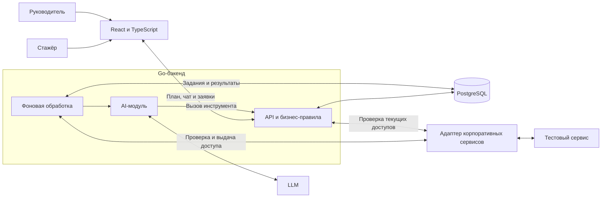
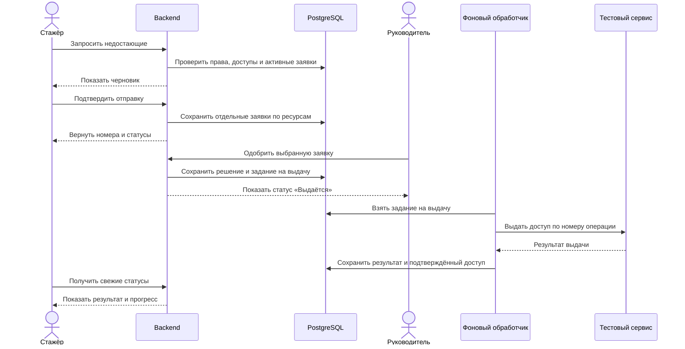

# AI-buddy — архитектура MVP

Для MVP проектируем один Go-бэкенд и одну базу PostgreSQL. AI-модуль и фоновые обработчики работают на стороне backend. Выдачу доступов для вики, YouTrack, GitLab и Grafana выполняет тестовый сервис.

## Компоненты

| Компонент | За что отвечает |
| --- | --- |
| Frontend | Отправляет действия пользователя и показывает состояния от API. |
| Backend | Определяет пользователя и права, готовит черновики, сохраняет заявки и решения руководителя, рассчитывает прогресс. |
| AI-модуль | Получает контекст выбранного пункта, вызывает разрешённые инструменты и формулирует ответ по полученным данным. |
| PostgreSQL | Хранит профили, правила доступов, историю чатов, заявки, подтверждённые доступы и фоновые задания. |

## Данные и прогресс

| Что храним | Как используем |
| --- | --- |
| Профиль, команда и роль | Показываем сведения о команде, руководителе и наставнике. По команде и рабочей роли выбираем обязательные ресурсы. |
| Правила доступа | Для каждого ресурса определяем нужный уровень доступа, основание запроса и согласующего. |
| Переписка | Храним отдельную историю для стажёра и пункта плана. Ответ привязываем к тому пункту, из которого пришёл запрос. |
| Черновик и заявки | В черновике сохраняем ресурсы и уровни, которые стажёр увидел перед отправкой. Для каждого подтверждённого ресурса создаём отдельную заявку со своим статусом. |
| Подтверждённые доступы | Учитываем ресурсы, к которым тестовый сервис подтвердил нужный уровень доступа. Сюда входят и доступы, полученные до начала адаптации. |
| Отметка о знакомстве | Сохраняем подтверждение стажёра по кнопке «Отметить знакомство». |

## Как работает чат

1. Стажёр отправляет сообщение из конкретного пункта. Backend проверяет, что пункт доступен этому стажёру, сохраняет сообщение и ставит обработку в очередь.
2. AI-модуль получает описание пункта, разрешённые данные профиля и команды, историю этого чата и нужные сведения о заявках.
3. Backend выполняет инструменты в контексте текущего пользователя и проверяет права на каждый ресурс. Помощник получает результат и объясняет, что можно сделать дальше.
4. Ответ сохраняется в исходном чате. Стажёр может открыть другой пункт, пока ответ готовится.

## Как проходят заявки на доступ

### Согласование и выдача

Руководитель видит заявки, назначенные ему на согласование. Backend принимает решение по заявке в статусе «На согласовании». Решение и новое состояние сохраняются одной операцией, поэтому при двух одновременных действиях применяется первое принятое решение.

## Ожидание и повторы

Долгие вызовы LLM и выдача доступов идут через фоновые задания в PostgreSQL. API быстро возвращает номер операции и её состояние. Пока операция выполняется, frontend показывает ожидание и периодически запрашивает статус. После перезагрузки он загружает актуальные данные, когда пользователь снова ввёл почту или ID.

## Права и интеграция

- Backend ищет демо-сотрудника по почте или внутреннему ID. Роль и назначенную команду он берёт из справочника сотрудников. При первом входе стажёр выбирает наставника своей команды, должность и дату начала стажировки.
- Интерфейс держит внутренний ID в памяти вкладки и передаёт его в заголовке X-Demo-Employee-Id. После перезагрузки пользователь вводит почту или ID снова.
- Стажёр читает свои задания, чаты и заявки. Руководитель работает с заявками, для которых назначен согласующим. Такой вход используется в изолированном демо с вымышленными сотрудниками. Для реальных данных нужна корпоративная проверка личности.
- Backend проверяет права при чтении данных, подтверждении заявки и принятии решения. В модель передаётся только разрешённый контекст текущего пункта.
- Тестовый сервис хранит состояние доступов для вымышленных пользователей. Для демо можно задать уже выданный доступ, успешную выдачу и сбой по отдельному ресурсу.
- При подключении корпоративного API адаптер преобразует запрос и ответ в те же операции проверки и выдачи. Правила согласования и расчёт прогресса выполняет backend.
