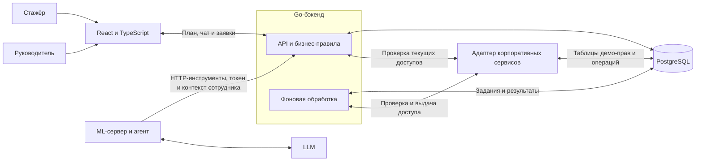
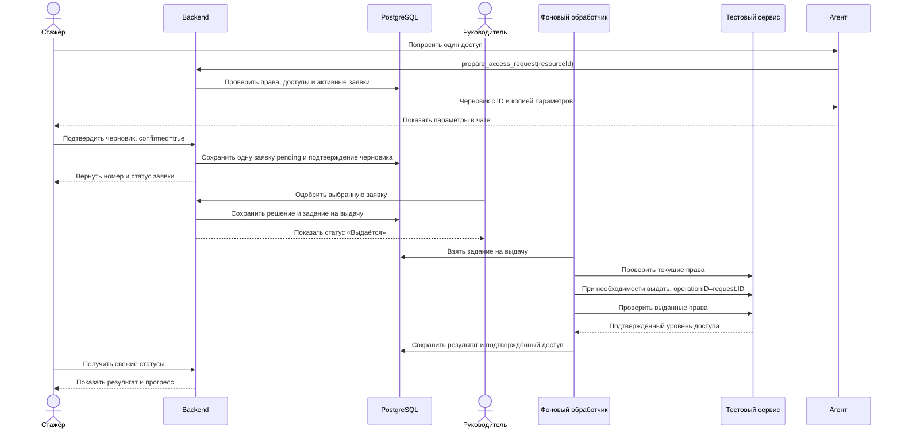

# AI-buddy — архитектура MVP

Для MVP используем Go API и PostgreSQL. В Go API реализованы вход, профили,
рабочие доступы, заявки, фоновая выдача и четыре HTTP-инструмента для ML.
ML-разработчик подключает инструменты к агенту и отвечает за промпты и разговор.
Выдачу выполняет демо-провайдер с отдельными таблицами прав и операций в той же БД.

Общий план, знакомство и хранение чата ниже описывают целевую интеграцию.
Их маршруты пока не зарегистрированы в Go API. Реализованные маршруты перечислены
в [роутере](../backend/internal/handler/router.go), контракт инструментов —
в [интерфейсе для ML](ml-tools.md).

## Компоненты

| Компонент | За что отвечает |
| --- | --- |
| Frontend | Отправляет действия пользователя и показывает состояния от API. |
| Backend | Определяет пользователя и права, готовит черновики, сохраняет заявки и решения руководителя, рассчитывает прогресс. |
| AI-модуль | Получает контекст выбранного пункта, вызывает разрешённые инструменты и формулирует ответ по полученным данным. |
| PostgreSQL | Хранит профили, правила доступов, заявки, подтверждённые доступы и фоновые задания. История чатов добавляется при подключении чата. |

## Данные и прогресс

| Что храним | Как используем |
| --- | --- |
| Профиль, команда и роль | Показываем сведения о команде, руководителе и наставнике. По команде и рабочей роли выбираем обязательные ресурсы. |
| Правила доступа | Для каждого ресурса определяем нужный уровень доступа, основание запроса и согласующего. |
| Переписка, целевая интеграция | Отдельная история для стажёра и пункта плана. Ответ привязывается к тому пункту, из которого пришёл запрос. |
| Черновик и заявки | Агент готовит черновик одного доступа с копией параметров. После подтверждения стажёром создаём одну заявку руководителю. [Модели и ограничения](../backend/internal/models/access_request.go). |
| Подтверждённые доступы | Учитываем ресурсы, к которым тестовый сервис подтвердил нужный уровень доступа. Сюда входят и доступы, полученные до начала адаптации. |
| Отметка о знакомстве, целевая интеграция | Подтверждение стажёра по кнопке «Отметить знакомство». |

## Как работает чат

Целевой сценарий после подключения ML и интерфейса:

1. Стажёр отправляет сообщение из конкретного пункта. Backend проверяет, что пункт доступен этому стажёру, сохраняет сообщение и ставит обработку в очередь.
2. AI-модуль получает описание пункта, разрешённые данные профиля и команды, историю этого чата и нужные сведения о заявках.
3. Backend выполняет инструменты в контексте текущего пользователя и проверяет права на каждый ресурс. Помощник получает результат и объясняет, что можно сделать дальше.
4. Ответ сохраняется в исходном чате. Стажёр может открыть другой пункт, пока ответ готовится.

## Как проходят заявки на доступ

### Согласование и выдача

Руководитель видит в списке только назначенные ему заявки `pending`.
Фильтры группы, статуса и ресурса для него игнорируются; пагинация работает.
Назначенный руководитель может открыть карточку и после решения.

При одобрении статус `issuing` и задание выдачи сохраняются в одной транзакции.
При отказе сохраняются `rejected` и обязательная причина. Конкурирующее другое
решение получает `409`; повтор того же решения с той же причиной возвращает
актуальную заявку.

Черновик содержит ровно один ресурс и действует 15 минут. Подготовка доступна
через `prepare_access_request`, публичного POST для создания черновиков нет.
Пользователь подтверждает его отдельным запросом с `confirmed=true`.
Параметры и владелец проверяются повторно. Созданная заявка с уникальным
`draft_id` служит сохранённым результатом: повтор подтверждения возвращает её.

## Ожидание и повторы

Фоновая выдача уже использует задания PostgreSQL: обработчик закрепляет задание
за собой на ограниченное время и сохраняет результат с проверкой токена владения.
Постоянный ID операции провайдера — строковый `request.ID`, а `request.number`
служит номером заявки для пользователя и назначается PostgreSQL автоматически.

После ошибки проверки или выдачи заявка переходит в `failed` и остаётся активной:
новую заявку на этот ресурс создать нельзя. Назначенный руководитель вызывает
повтор выдачи; он возвращает прежнюю заявку в `issuing`. Обработчик сначала
проверяет фактические права, в том числе после тайм-аута предыдущей попытки.
Автоматического повторения завершившейся ошибкой попытки нет.

Прогресс растёт только после подтверждённой выдачи и обновления `EmployeeAccess`.
Пока заявка обрабатывается, интерфейс может опрашивать её карточку и карточку
ресурсов. Организация фоновых ответов LLM относится к ML-модулю и чату.

## Права и интеграция

- Backend ищет демо-сотрудника по почте или внутреннему ID. Роль и назначенную команду он берёт из справочника сотрудников. При первом входе стажёр выбирает наставника своей команды, должность и дату начала стажировки.
- Интерфейс держит внутренний ID в памяти вкладки и передаёт его в заголовке X-Demo-Employee-Id. После перезагрузки пользователь вводит почту или ID снова.
- Стажёр читает свои задания, чаты и заявки. Руководитель работает с заявками, для которых назначен согласующим. Такой вход используется в изолированном демо с вымышленными сотрудниками. Для реальных данных нужна корпоративная проверка личности.
- Backend проверяет права при чтении данных, подтверждении заявки и принятии решения. В модель передаётся только разрешённый контекст текущего пункта.
- Тестовый сервис хранит состояние доступов для вымышленных пользователей. Для демо можно задать уже выданный доступ, успешную выдачу и сбой по отдельному ресурсу.
- При подключении корпоративного API адаптер преобразует запрос и ответ в те же операции проверки и выдачи. Правила согласования и расчёт прогресса выполняет backend.
